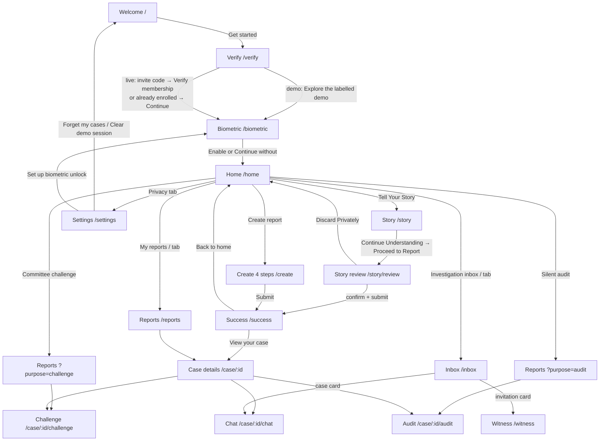
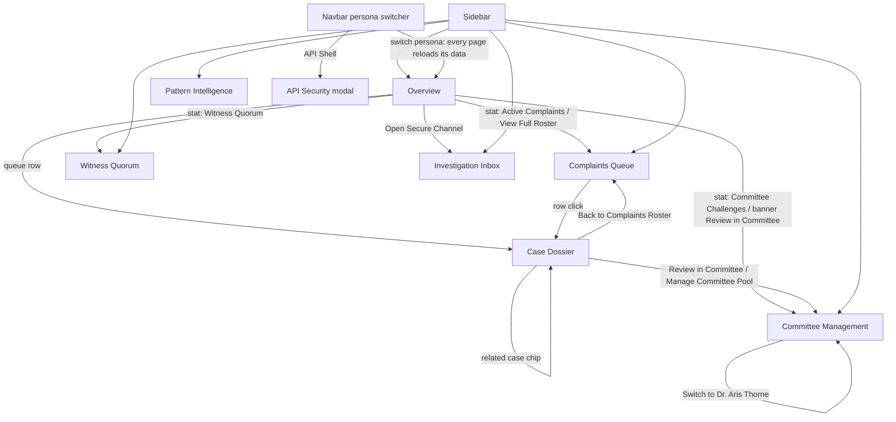

# INCOGNITO frontend flow map

Status: as-built map of every page and screen on branch `feat/m3-integration` (2026-10-11). This document describes
what exists today. It does not propose designs. Section 7 lists observed gaps so the team can decide on UI work.

INCOGNITO has two frontends that share one backend (`shared/api-contract.yaml` for the app, `/hr/*` for the dashboard):

| Frontend | Users | Stack | Source | Navigation model |
|---|---|---|---|---|
| Employee app | Reporters and witnesses (anonymous) | Flutter, Riverpod, go_router | `mobile/lib/` | URL routes with a session guard; bottom tab bar |
| HR dashboard | HR, investigators, committee members, independent reviewer | React 19, Vite, Tailwind | `web/src/` | In-memory page state (no URLs); fixed sidebar |

Both run in two modes:

| | Employee app | HR dashboard |
|---|---|---|
| Demo / mock | `APP_MODE=demo` (default): `DemoRepository`, in-memory fixtures, "demo" wording | `VITE_FORCE_MOCK=true`, or automatic fallback when the backend is unreachable |
| Live | `APP_MODE=live`: `LiveRepository` + `WebViewProver` (`ZK_PROVER=offline` for the offline stub) | Default: calls `/hr/*` with `X-Stub-Admin` and `X-Staff-Id` |

---

## 1. Employee app (Flutter)

### 1.1 Route table

`mobile/lib/app.dart`. Every route except `/` and `/verify` redirects to `/` while the session is not entered
(`sessionProvider == false`). The session is in memory only, so an app restart always starts at `/`.

| Route | Screen | Tab | Reached from | Requires `extra` |
|---|---|---|---|---|
| `/` | WelcomeScreen | - | App start; redirect target; Settings "clear" | - |
| `/verify` | VerificationScreen | - | Welcome "Get started" | - |
| `/biometric` | BiometricScreen | - | Verification; Settings "Set up biometric unlock" | - |
| `/home` | HomeScreen | Home (0) | Biometric; tab bar; Success "Back to home"; Story "Discard" | - |
| `/reports` | ReportsScreen | Reports (1) | Tab bar; Home tiles | - |
| `/reports?purpose=challenge` | ReportsScreen ("Choose a case to challenge.") | Reports (1) | Home "Committee challenge" tile | - |
| `/reports?purpose=audit` | ReportsScreen ("Follow the record.") | Reports (1) | Home "Silent audit" tile | - |
| `/inbox` | InboxScreen | Inbox (2) | Tab bar; Home "Investigation inbox" tile | - |
| `/settings` | SettingsScreen ("Privacy") | Privacy (3) | Tab bar | - |
| `/create` | CreateReportScreen (4 steps) | - | Home "Create report"; Reports "Create a report" | - |
| `/story` | TellYourStoryScreen | - | Home "Tell Your Story"; empty review "Tell Your Story" | - |
| `/story/review` | StoryReviewScreen | - | Story "Proceed to Report" | - |
| `/success` | SuccessScreen | - | Create submit (`pushReplacement`); Story submit (`go`) | `Report` (else falls back to ReportsScreen) |
| `/case/:id` | DetailsScreen | - | Reports list; Success "View your case" | `Report` (else ReportsScreen) |
| `/case/:id/chat` | ChatScreen | - | Details; Inbox list | `Report` (else ReportsScreen) |
| `/case/:id/challenge` | ChallengeScreen | - | Details; Reports (purpose=challenge) | `Report` (else ReportsScreen) |
| `/case/:id/audit` | AuditScreen | - | Details; Reports (purpose=audit) | `Report` (else ReportsScreen) |
| `/witness` | WitnessScreen | - | Inbox invitation card | `Invitation` (else InboxScreen) |

### 1.2 Global shell and overlays

| Element | Where | Behaviour |
|---|---|---|
| `PageShell` | `widgets/components.dart` | Gradient background, scrollable single column (24 px padding), back arrow when the stack can pop, "INCOGNITO" mark, a fixed **"DEMO WORKSPACE · LOCAL DATA"** label (shown in live mode too), page title, optional bottom tab bar |
| Bottom tab bar | `PageShell(tab:)` | Home / Reports / Inbox / Privacy; uses `context.go` (replaces the stack) |
| `DeviceLock` overlay | `core/device_lock.dart` | When the app is backgrounded and biometrics are enabled, the whole UI is replaced by "Your workspace is locked." with **Unlock** (biometric prompt) and **Clear session and start again** (clears biometric flag and session; case tokens remain) |
| `ActionButton` | components | Full-width filled button; shows a spinner and disables while `busy` |
| `HintCard`, `SoftCard` | components | Info card with icon; rounded tappable card |
| Feedback | `feedback()` | All success and error messages are SnackBars, except the Story review error (inline HintCard) |
| Theme | `core/theme.dart` | Purple `#8E4DDF`, ink `#18171F`, rounded inputs and buttons, Material 3 |

### 1.3 Journey



### 1.4 Screens

#### Welcome `/`
- **Purpose:** first impression and entry.
- **Content:** shield illustration, "A safer way to speak up.", value statements.
- **Interactions:** **Get started** → `/verify`. No back button.
- **States:** static.

#### Verification `/verify`
- **Purpose:** anonymous membership enrolment.
- **Demo:** info cards ("Waiting for the verification contract") and **Explore the labelled demo** → enters the demo
  session → `/biometric`.
- **Live:**
  - On open, checks `isEnrolled()` (GET `/zk/group` + local commitment from the WebView prover).
  - **Enrolled:** "This phone is already a verified member." → **Continue** → `/biometric`.
  - **Not enrolled:** **Invite code from HR** field → **Verify membership** (busy spinner).
    Calls POST `/zk/enroll` with the commitment, then enters the session → `/biometric`.
  - **Errors (SnackBar):** bad code ("That invite code was not accepted…"), network, prover failure.
- **States:** while the enrolment check runs there is no loading indicator; the code form shows until it answers.

#### Biometric `/biometric`
- **Purpose:** optional device lock.
- **Interactions:**
  - **Enable biometric unlock** runs the OS biometric prompt; on success it stores `biometric_enabled` and goes to `/home`.
  - **Continue without biometrics** → `/home`.
- **Errors (SnackBar):** biometrics unavailable; authentication unavailable.
- Reached on **every** session start, because the session is not persisted.

#### Home `/home` (tab 0)
- **Purpose:** hub.
- **Content:**
  - Card "Space to understand" with **Tell Your Story** → `/story` and **Create report** → `/create`.
  - Four tiles (2 columns, 1 column below 290 px width):
    - My reports → `/reports`;
    - Investigation inbox → `/inbox`;
    - Committee challenge → `/reports?purpose=challenge`;
    - Silent audit → `/reports?purpose=audit`.
- **States:** static. No back button.

#### Tell Your Story `/story`
- **Purpose:** private, temporary narrative space before deciding to report. Nothing leaves the phone here.
- **Content:**
  - Privacy hint and a narrative text field (7 to 16 lines).
  - After **Continue Understanding** (enabled when text is not empty): fixed example categories (Harassment, Bullying,
    Discrimination, Abuse of Authority) as toggle cards, an "Only if it helps" question card, and **Proceed to Report**.
- **Interactions:**
  - Typing clears selections.
  - Tapping a category card toggles it.
  - **Proceed to Report** → `/story/review`.
  - **Discard Privately** clears the draft → `/home`.
  - System back also discards the draft.
- **State:** draft lives in `storyProvider` memory only; it is cleared on session end.
- **Note:** live category suggestions from the server were removed by M1 (privacy: no text leaves before confirmation).

#### Story review `/story/review`
- **Purpose:** explicit-consent gate before a formal report.
- **Content:** exact narrative (selectable), selected categories (or "Uncertain"), attachments list with remove, live/demo
  explanation, consent checkbox.
- **Interactions:**
  - **Select an attachment:** file picker (pdf, txt, docx, jpg, jpeg, png; up to 5 files, 20 MB each).
    Adding or removing a file un-ticks consent.
  - **Confirm and submit report:** enabled only when consent is ticked. Live mode proves membership, sends POST
    `/reports`, uploads attachments, then goes to `/success`.
  - **Continue Understanding:** goes back to `/story`.
  - **Discard Privately:** goes to `/home`.
- **States:**
  - **Empty:** "Your private space is clear." with **Tell Your Story** (when no narrative).
  - **Busy:** back navigation blocked.
  - **Error:** inline HintCard (e.g. "already submitted today", prover or network failure).

#### Create report `/create` (4 steps, progress bar "STEP n OF 4")
1. **What happened?** Single-select category cards: Harassment, Bullying, Discrimination, Bribery, Whistleblowing,
   Abuse of Authority, Other. **Continue** is disabled until one is chosen.
2. **In your own words.**
   - Anonymity hint.
   - **Incident title:** 5 to 120 characters.
   - **What would you like us to know?:** 20 to 10,000 characters.
   - **Approximate date:** date picker, up to today.
   - **Continue** validates the form.
3. **Supporting context.** **Choose an image** (gallery) and **Choose a document** (pdf, txt, docx, png, jpg). Up to 5
   files, under 20 MB each. File cards show size, an image preview and **Remove**. Evidence is optional.
4. **Take a moment to review.** Summary card plus a hint ("one report per day" in live mode). **Submit anonymously**
   (live) or **Create local demo report** (demo).

- **Navigation:** **Previous step** on steps 2 to 4. On success → `/success` (replaces this page).
- **Errors (SnackBar):** e.g. replay ("already submitted… one report per day"), claim-integrity rejection, network,
  prover. The draft is kept.

#### Success `/success`
- **Content:** check icon, case ID, text ("Report accepted and sealed on Polygon. Keep this phone…" in live mode).
- **Interactions:** **View your case** → `/case/:id`; **Back to home** → `/home`.

#### Reports `/reports` (tab 1)
- **Purpose:** the reporter's cases on this phone, read using the case tokens stored on the device.
- **Content:** **Create a report** button; one card per case (ID, category, status, incident/submission date, "View case").
- **Purpose variants:**
  - `?purpose=challenge` changes the title and opens `/case/:id/challenge`.
  - `?purpose=audit` changes the title and opens `/case/:id/audit`.
- **States:**
  - **Loading:** centred spinner.
  - **Error:** a button "Could not load reports · Retry".
  - **Empty:** "No reports yet. You can start whenever you are ready."

#### Case details `/case/:id`
- **Content:** ID, title, category, description, date, status, evidence count ("uploaded and sealed" when live), a hint
  about the case token, and the **outcome card** (live, once HR has resolved the case).
- **Outcome card (Reflect & Reform):**
  - Shows the outcome and reform actions.
  - If no feedback has been given yet: a **fairness** slider (1 to 5), **I felt safe reporting** and **I would report
    again** switches, and **Share feedback** (once only).
  - After feedback: "You shared feedback on this case."
- **Interactions:** **Investigation inbox** → chat; **Challenge committee** → challenge; **View Silent Audit** → audit.

#### Challenge `/case/:id/challenge`
- **Purpose:** anonymous Committee Challenge.
- **Content:**
  - Case ID and an explanation hint.
  - **Who concerns you?** Radio list of the case's committee (name, plus role when live).
  - **Potential conflict** dropdown: Professional relationship, Personal relationship, Prior involvement, Other.
  - **Explain your concern:** at least 15 characters.
  - **Submit challenge** button.
  - Below it, a card per filed challenge showing member, reason and status (e.g. "Submitted · independent review pending").
- **Errors (SnackBar):** replay ("already challenged"), network, prover.
- **States:** if the committee list is empty, there is no empty state; the form shows with no options.

#### Chat `/case/:id/chat`
- **Purpose:** anonymous investigation inbox for one case.
- **Content:**
  - Hint, then **Check for replies** (live only; re-reads the case).
  - Message bubbles: right side for "You", left side for "Investigation team"; each shows sender, text and time.
  - **Your reply** field (max 4,000 characters) and a **Send reply** button.
- **States:** no empty state when there are no messages. A failed send shows a SnackBar and keeps the draft.

#### Inbox `/inbox` (tab 2)
- **Content:**
  - **Refresh inbox** button.
  - "Investigations": one card per case → its chat.
  - "Witness invitations" with, in live mode, a **Witness code** field and **Show my invitations** (saves the code on
    the device). Then the invitation cards (ID, response or "Participation is your choice") → `/witness`.
- **States:**
  - **Loading:** inline spinner, not centred.
  - **Error:** HintCards ("Inbox unavailable…", "Invitations unavailable…").
  - **Empty:** no empty-state message for either list.

#### Witness `/witness`
- **Content:** invitation ID and context, a voluntary-participation hint.
- **Interactions:** **Accept invitation** or **Decline invitation**. After responding: "Response recorded: accept. Thank you."
- **Errors (SnackBar):** e.g. already responded.

#### Silent Audit `/case/:id/audit`
- **Content:**
  - Hint and **Refresh timeline** button.
  - Expandable cards per audit event: title, plus state such as "Verified on Polygon", "Sealed, waiting for the next
    Polygon anchor" or a failure state (orange icon).
  - Expanded detail: "Sealed at …, anchored in tx 0x…" with a Polygonscan link (as text), the receipt hash, and
    **Copy receipt**.
- **States:**
  - **Loading:** centred spinner.
  - **Error:** HintCard "Audit unavailable. Refresh to retry."

#### Settings / Privacy `/settings` (tab 3)
- **Content:** anonymity limits hint; About card.
- **Interactions:**
  - **Set up biometric unlock** → `/biometric`.
  - **Disable biometric unlock:** SnackBar confirmation.
  - **Forget my cases on this phone** (live) or **Clear local demo session** (demo): clears the biometric flag, case
    tokens (live) and the session → `/`. There is no confirmation dialog.

### 1.5 Responsive behaviour (app)
- Single-column layout on all screens; titles use fixed line breaks.
- The Home tiles switch to one column below 290 px.
- Message bubbles are capped at 320 px wide.
- M1's widget tests cover a 360×740 phone and enlarged text.
- There is no tablet or landscape-specific layout.

---

## 2. HR dashboard (React)

### 2.1 Page table

`web/src/App.tsx` switches pages through `currentPage` state. There are no URLs: browser back, refresh and deep links
all return to Overview, and the selected case is kept only in memory.

| Page key | Component | Sidebar label | Reached from |
|---|---|---|---|
| `dashboard` | `pages/Dashboard.tsx` | Overview | Start; sidebar |
| `reports` | `pages/Reports.tsx` | Complaints Queue | Sidebar; Overview stat card and "View Full Roster"; case "Back to Complaints Roster" |
| `report_details` | `pages/ReportDetails.tsx` | (highlights Complaints Queue) | Queue row; Overview queue row; related-case chips |
| `committee` | `pages/CommitteeManagement.tsx` | Committee Management (badge = pending challenges) | Sidebar; Overview challenge card and banner; case page links |
| `witness` | `pages/WitnessQuorumPage.tsx` | Witness Quorum | Sidebar; Overview stat card |
| `inbox` | `pages/InvestigationInboxPage.tsx` | Investigation Inbox | Sidebar; Overview "Open Secure Channel" |
| `repeat_allegations` | `pages/RepeatAllegations.tsx` | Pattern Intelligence | Sidebar |

### 2.2 Global shell
- **Sidebar** (`components/layout/Sidebar.tsx`): fixed purple panel on the left, 256 px wide.
  - INCOGNITO branding.
  - Six nav items with an active pill; Committee Management carries an amber badge with the pending-challenge count.
  - Profile footer (avatar, name, role).
- **Navbar** (`components/layout/Navbar.tsx`):
  - "Welcome, \<name\>" pill, current page badge, role badge.
  - **Persona switcher** dropdown (closes on outside click or Escape). It lists six demo staff and has two tools:
    - **API Shell**: opens the modal below.
    - **Reset Demo**: native `confirm()`, then reloads the page. It resets mock state only.
  - **Notification bell**: shows a dot when challenges are pending; no action on click.
  - Avatar with name and email.
- **ApiSecurityModal** (`components/layout/ApiSecurityModal.tsx`):
  - Persona select, endpoint select, then run.
  - Probes (the case ID is the user's first real case): case details, challenge `CH-104` (a mock ID), the case queue,
    witness roster, and the audit trail.
  - Shows status, body, headers and timing, with a copy button.
- **Page transition:** `page-enter` animation keyed by page.

### 2.3 Personas and what changes

Persona selection sets `X-Staff-Id`; the backend enforces access.

| Persona | Role | Sees cases | Notable powers and limits |
|---|---|---|---|
| Sarah Jenkins (default) | hr_reviewer | All | Resolve cases; message the reporter; export PDF; Reflect & Reform insights; cannot rule on challenges or invite witnesses |
| Elena Rostova | assigned_investigator | Assigned (all stub cases) | Message the reporter; invite witnesses (sees code); full witness detail; resolve; export |
| Marcus Vance | committee_member | Cases on his committee | Cannot see challenges against himself; after an upheld challenge: 403 "Access Revoked" and the attempt is audited |
| David Kim | committee_member | Cases on his committee | Read-only |
| Priya Sundaram | committee_member | Cases where she replaced someone | Read-only |
| Dr. Aris Thorne | independent_reviewer | All | Only role that can approve or dismiss challenges; insights; export |

### 2.4 Journey



### 2.5 Pages

#### Overview `dashboard`
- **Stat cards:**

  | Card | Data | Click |
  |---|---|---|
  | Active Complaints Queue | Live count, plus "n Critical" badge | Complaints Queue |
  | Committee Challenges | Live pending count | Committee Management |
  | Witness Quorum Live | Static "2 Active" | Witness Quorum |
  | Cryptographic Integrity | Static "100%" | None |
- **Case Resolution Trends:** SVG line chart with hover. Sample data, labelled "Illustrative".
- **Reflect & Reform card:** shown only for live HR and oversight roles.
  - Resolved count.
  - Ratings, hidden with an explanation below 3 responses.
  - Reform-action chips.
- **Conflict-challenge banner:** first pending challenge; **Review in Committee**.
- **Priority Investigation Queue:** first 4 cases in the complaint table, then **View Full Roster**.
- **Right column:** all static.
  - Calendar (October 2026, fixed days).
  - "Investigation Milestones" checklist (fixed tasks referencing INC-892; toggling works locally).
  - "Anonymous Relay Feed" (fixed message) with **Open Secure Channel**.
- **States:** "Loading cases..." text for the queue; no error state.

#### Complaints Queue `reports`
- **Header:** count badge; committee-member restriction notice.
- **Filters:** search (case ID, title, anonymous token); category (4 options); severity; status (3 options). All filtering
  happens in the browser.
- **Table** (horizontal scroll), columns:
  - Case ID, with a "REVOKED" tag for revoked users;
  - category, severity badge, status badge;
  - anonymous token, filed date, next action, inspect arrow.

  Clicking a row → Case Dossier.
- **States:**
  - **Loading:** "Retrieving authorized case dockets...".
  - **Empty or no match:** "No complaints match current filters or authorization scope."
  - **Error:** no error state.

#### Case Dossier `report_details`
- **Top bar:** **Back to Complaints Roster**; severity and status badges.
- **Header card:**
  - Case ID, reporter token, title.
  - If under challenge: an amber banner with **Review in Committee**.
  - Narrative ("Grievance Particulars").
  - Metadata: department scope, submitted time, blockchain seal reference.
  - Committee chips, with a revoked chip, and **Manage Committee Pool →**.
- **Case outcome & legal record** (`components/case/CaseActionsPanel.tsx`):
  - **Legal Evidence Package (PDF):** export roles only; downloads the file and shows a confirmation with the export ID.
  - **Related cases:** "same subject" chips (amber) and "similarity 0.xx" chips (purple); clicking opens that case.
  - **Resolution:**
    - When resolved: outcome, summary and actions.
    - Otherwise, for resolve roles in live mode: a form with outcome, summary (at least 15 characters) and reform actions
      (comma-separated), then **Record resolution**.
  - Success and error messages show inline.
- **Cryptographic Evidence Vault:**
  - Per file: name, size, SHA-256, ZK commitment, and **Verify Seal** (or "Proof Validated").
  - "Encrypted at Rest" badge and a private-storage notice.
- **Witness Quorum panel:** the same component as the Witness Quorum page (below).
- **States:**
  - **Loading:** "Verifying backend case authorization…".
  - **403 / error:** `AccessDeniedBanner` (red; message from the server; fixed "Security Audit Receipt" lines; **Back to
    Queue**, **Retry API Request**).

#### Committee Management `committee`
- **Header:** for non-reviewers with pending challenges, a **Switch to Dr. Aris Thorne** shortcut.
- **Pool selector:** five pools, with mandate and description. The default is Whistleblowing & Ethics.
- **Challenge notice:**
  - **Pending:** amber "Action Required…" with a **Jump to Adjudication ↓** anchor link.
  - **Clean:** green "Clean Pool Status".
- **Committee Roster:** cards per member with conflict risk, status badge (Active Assignment, Conflict Challenged,
  Recused & Revoked, Available), and assigned cases. Actions:
  - **Review Challenge**;
  - **Assign to Docket** (HR) or **View Disclosure**;
  - a "Ineligible for Case INC-892" label for recused members.
- **Assignment modal:** "Assign \<member\> to Case INC-512 (Vendor Procurement Integrity)?" with Cancel / **Confirm
  Assignment**. Confirm shows a native `alert()` only; no API call is made.
- **Conflict Challenges** list, one `ChallengeReviewPanel` per challenge:
  - **Challenged member viewing:** amber "Confidential Conflict Adjudication in Progress" lock card.
  - **Pending:** challenge ID, case, filed time, challenged appointee, reporter's grounds.
    - Non-reviewers get a "switch to Dr. Aris Thorne" prompt and a disabled form.
    - Reviewers get: a rationale textarea (pre-filled Marcus-specific text), a replacement select (Priya Sundaram or
      Tariq Mansoor), **Dismiss Challenge**, and **Approve & Revoke Access Immediately**.
    - Clicking a decision as a non-reviewer triggers a native `alert()`.
  - **Resolved:** green adjudication record (decided time, rationale, revocation state text).
- **States:** "Loading committee roster…"; empty pool: "No Active Challenges in \<pool\> Pool".

#### Witness Quorum `witness`
- **Header:** case select (the user's accessible cases), then the **Witness Quorum panel**.
- **Witness Quorum panel:**
  - Privilege badge: "Investigator Full Privilege" or "Redacted".
  - Four stats: invited, accepted (`***` when masked), statements, pending (`***` when masked).
  - Participation log (alias, invited and responded dates, status chip).
  - Investigators also get an alias input and **Issue Invite**. After inviting, a one-time witness code is shown (green
    box), to hand to the witness privately.
  - Other roles see "Only the assigned investigator … can issue new witness invitations."
  - An ethics banner.
- **States:** "No cases available for your role." when the list is empty. The log has no empty-state text.

#### Investigation Inbox `inbox`
- **Header:** case-channel select (accessible cases), then the chat panel.
- **Chat panel:**
  - Fixed 580 px height.
  - Header badges: "End-to-End PGP Encrypted" and "ZK-Nullifier Active".
  - Message stream; the current user's messages are on the right.
  - Input and **Send**.
  - Footer: "ECDSA-secp256k1 verified".
- **States:**
  - **403:** red "Encrypted Channel Access Restricted" card (e.g. for revoked members).
  - Sending to a role that can't message: `alert()` with the error.
  - **Empty:** no empty or loading state for messages.

#### Pattern Intelligence `repeat_allegations`
- **Header and ethics banner** ("A report's existence is not proof of guilt…").
- **Live:**
  - "Repeat allegations against the same person (SUBJ-xxxx)" clusters (categories, count, case IDs).
  - "Similar incident descriptions" pairs (method, similarity, limitation).
- **Mock:** M2's two sample clusters, with "Sample clusters shown…".
- **Empty (live):** "No repeat subjects or similar reports…".
- Case IDs in clusters are not clickable.

### 2.6 Responsive behaviour (dashboard)
- The content area is offset 280 px from `md` (768 px) up.
- **Below 768 px the fixed sidebar still renders,** with no hamburger or collapse, so it covers the content.
- The navbar hides the page badge below `sm` and the name/email below `lg`.
- Stat cards: 1, 2 or 4 columns. Overview main grid: 1 or 12 columns.
- The complaint table scrolls horizontally. Roster and pattern grids: 1 or 2/3 columns.
- Modals are centred, `max-w-md`, with padding.

### 2.7 Present but unused
- **Components never rendered:**
  - `components/audit/AuditTimeline.tsx`: Silent Audit timeline with a simulated "Verify Cryptographic Trail";
  - `components/committee/CommitteeAssignmentPanel.tsx`;
  - `components/ui/EmptyState.tsx`;
  - `components/ui/LoadingState.tsx`.
- The dashboard therefore has **no page showing a case's Silent Audit timeline**. The audit is only reachable through
  the API Shell modal.

---

## 3. Cross-app flows (reporter ↔ HR)

```mermaid
sequenceDiagram
  participant R as Reporter app
  participant B as Backend
  participant H as HR dashboard
  R->>B: enrol (invite code, commitment)
  R->>B: POST /reports (ZK proof) + evidence
  B-->>H: case appears in Queue (severity, status)
  H->>B: investigator message (Inbox)
  R->>B: Check for replies / send reply
  R->>B: Committee Challenge (ZK proof)
  B-->>H: Committee badge, Overview banner, challenge panel
  H->>B: Dr. Aris Thorne approves/dismisses
  B-->>R: Challenge status, new committee on Challenge screen
  B-->>H: Revoked member gets 403
  H->>B: Elena invites witness → witness code
  R->>B: witness enters code, accepts/declines
  B-->>H: Witness log updates (masked for non-investigators)
  H->>B: Record resolution + reform actions
  B-->>R: Outcome card on Case details
  R->>B: Reflect & Reform feedback
  B-->>H: Insights card (once ≥3 responses)
  R->>B: Silent Audit timeline (both sides write events; app shows them)
```

| Flow | Reporter screens | HR pages |
|---|---|---|
| Report intake | Story → Review → Success, or Create (4 steps) → Success | Queue, Overview queue, Case Dossier |
| Anonymous inbox | Inbox → Chat ("Check for replies") | Investigation Inbox; Overview "Open Secure Channel" |
| Committee Challenge | Home tile or Details → Challenge | Overview banner, Committee Management, Case Dossier banner |
| Witness Quorum | Inbox (witness code) → Witness | Witness Quorum page, Case Dossier panel |
| Resolution / Reflect & Reform | Details outcome card | Case Dossier resolution form; Overview Reflect & Reform card |
| Silent Audit | Audit screen | Not shown (only API Shell); events surface indirectly via evidence status |
| Legal export | - | Case Dossier PDF button |
| Pattern intelligence | - (no subject picker in the app) | Pattern Intelligence; Case Dossier related cases |

---

## 4. State coverage matrix

✓ = implemented, - = not applicable, **gap** = missing.

| Screen / page | Loading | Empty | Error | Busy / disabled |
|---|---|---|---|---|
| App Verify (live) | **gap** (enrolment check) | - | SnackBar | ✓ |
| App Reports | ✓ | ✓ | ✓ (retry) | - |
| App Inbox | ✓ (inline) | **gap** (both lists) | ✓ | - |
| App Chat | - | **gap** | SnackBar | ✓ |
| App Challenge | - | **gap** (no committee) | SnackBar | ✓ |
| App Audit | ✓ | **gap** | ✓ | - |
| App Story review | - | ✓ | ✓ inline | ✓ |
| App Create | - | - | SnackBar | ✓ |
| Web Overview | ✓ (queue) | **gap** | **gap** | - |
| Web Queue | ✓ | ✓ | **gap** | - |
| Web Case Dossier | ✓ | - | ✓ (403 banner) | ✓ (actions) |
| Web Committee | ✓ | ✓ (challenges) | **gap** (decision errors inline only) | ✓ |
| Web Witness | **gap** | partial | **gap** | ✓ |
| Web Inbox | **gap** | **gap** | ✓ (403 card); send errors via `alert()` | ✓ |
| Web Patterns | **gap** | ✓ (live) | **gap** (shows sample clusters) | - |

---

## 5. Data sources per screen (unchanged backend)

| Screen / page | Calls |
|---|---|
| App Verify | GET `/zk/group`, POST `/zk/enroll` |
| App Create / Story review | GET `/zk/group`, `/zk/scopes/complaint`, POST `/reports`, POST `/reports/{id}/evidence` |
| App Reports / Details / Chat | GET `/reports/{id}`, GET/POST `/reports/{id}/messages`, POST `/reports/{id}/reflection` |
| App Challenge | GET `/zk/scopes/challenge`, POST `/reports/{id}/challenge` |
| App Inbox / Witness | GET `/witness-invitations`, POST `/witness-invitations/{id}/respond` |
| App Audit | GET `/audit/cases/{id}/verify`, `/audit/cases/{id}/receipts` |
| Web Overview / Queue | GET `/hr/cases`, `/hr/challenges`, `/hr/insights` |
| Web Case Dossier | GET `/hr/cases/{id}`, `/hr/cases/{id}/related`, `/hr/cases/{id}/export.pdf`, POST `/hr/cases/{id}/resolve`, witness calls |
| Web Committee | GET `/hr/committee-pool`, `/hr/challenges?pool_id=`, POST `/hr/challenges/{id}/decide` |
| Web Witness | GET `/hr/cases/{id}/witnesses`, `/witness-summary`, POST `/hr/cases/{id}/witnesses` |
| Web Inbox | GET/POST `/hr/cases/{id}/messages` |
| Web Patterns | GET `/hr/patterns` |

---

## 6. How to run both for review

- **Backend:** `cd backend && CHAIN_MODE=offline STUB_ADMIN_KEY=adm ../.venv/bin/uvicorn app.stub.main:app --port 8000`
- **Dashboard:** `cd web && VITE_API_BASE_URL=http://localhost:8000 VITE_STUB_ADMIN_KEY=adm npm run dev`
- **App:**
  - `cd mobile && flutter run --dart-define=APP_MODE=live --dart-define=API_BASE_URL=http://<laptop IP>:8000`
  - add `--dart-define=ZK_PROVER=offline` against the offline backend;
  - the demo app needs no backend.

---

## 7. Observed gaps and inconsistencies (no fixes applied)

Recorded from the code and checked against the running backend where noted. They are inputs for the UI decision, not
changes.

**Functional mismatches**
1. **App categories vs backend (checked):**
   - The Create form offers **Bribery** and **Whistleblowing**, but the backend accepts Harassment, Sexual Harassment,
     Bullying, Discrimination, Abuse of Authority, Retaliation, Fraud, Safety and Other.
   - A live report in those two categories is rejected (`unknown_category`) and the user sees the generic "Submission
     failed" message.
   - The backend's Sexual Harassment, Retaliation, Fraud and Safety are not offered in the app.
2. **Default committee pool hides live challenges (checked):**
   - Committee Management opens on Whistleblowing & Ethics, but a bullying case's challenge is filed under Workplace
     Conduct (0 vs 1 challenges).
   - The Overview banner sends the reviewer to a page that says "Clean Pool Status".
3. **Replacement options:** the challenge panel offers "Tariq Mansoor", who is not in the backend staff list. The
   backend silently picks another member.
4. **Fake actions:**
   - **Assign to Docket** confirmation only shows `alert()`.
   - Evidence **Verify Seal** is a 0.7 s timer, not the verify API.
   - The unused AuditTimeline "Verify Cryptographic Trail" is a timer too.
5. **Witness invite:** the dashboard requires an alias, while the API supplies a default when it is blank.

**Static or sample content shown in live mode**
6. Overview: the Witness "2 Active" and "100%" integrity cards, the calendar, the milestones (INC-892), the "Anonymous
   Relay Feed" and the trends chart.
7. Case Dossier hard-codes "Marcus Vance" in the challenge banner and revoked chip, and maps committee IDs to fixed names.
8. Committee roster labels "Ineligible for Case INC-892"; the modal says "Case INC-512"; the challenge rationale is
   pre-filled with Marcus-specific text; success text names Priya Sundaram whoever was chosen.
9. App `PageShell` always shows **"DEMO WORKSPACE · LOCAL DATA"**, even in live mode.

**Claims that don't match the implementation**
10. Inbox badges "End-to-End PGP Encrypted" and "ECDSA-secp256k1 verified": messages are not end-to-end encrypted.
    They are TLS in transit and AES-GCM at rest when persisted.
11. AccessDeniedBanner's "Security Audit Receipt" lines are fixed text, not values returned by the server.

**Navigation and session**
12. **Dashboard:** no URLs, so refresh, browser back and links always land on Overview.
13. **App:** case routes need an in-memory `Report`; a cold deep link or restored route falls back to Reports. The
    session is not persisted, so every launch repeats Welcome → Verify → Biometric.
14. **App Settings "Forget my cases":** clears case tokens with no confirmation dialog (irreversible).
15. **Dashboard Reset Demo** affects mock data only; the notification bell has no action.

**States and layout**
16. Missing states, per section 4: app Inbox/Chat/Audit empty states, dashboard Inbox and Witness loading/empty, and
    Overview and Queue errors.
17. The dashboard sidebar overlaps the content below 768 px (no collapse).
18. Pattern Intelligence: case IDs are not links; no loading state; a failed live call silently shows the sample
    clusters; the unused `filterDepartment` state has no UI.
19. Dashboard has no Silent Audit timeline page, although the backend serves one per case.

### Questions to settle before UI work
- Should live mode remove all static Overview widgets, or replace them with live equivalents?
- Should the app's category list come from `GET /categories`, so both stay in sync?
- Should Committee Management default to "all pools" or to the pool of the pending challenge?
- Should the dashboard gain real URLs (case links, back button) and a mobile sidebar?
- Should the dashboard show the Silent Audit timeline on the Case Dossier?
- Which security claims should the UI make, given what is actually implemented?
